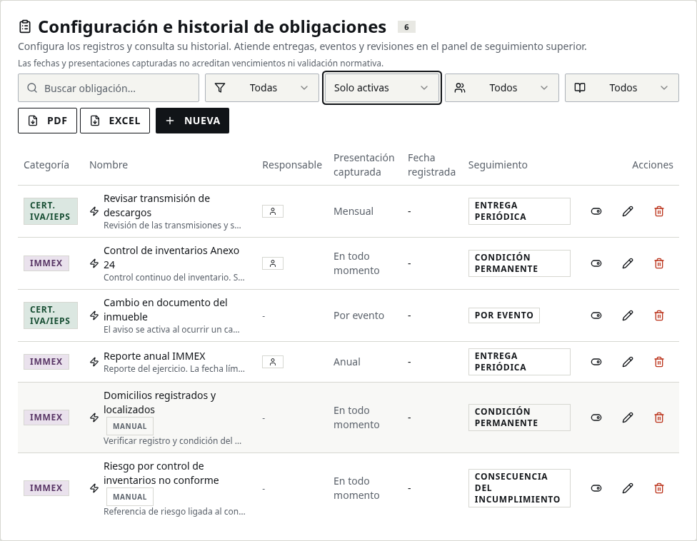

# Organización y conciliación de obligaciones — 19 de octubre de 2026

## Alcance

Inventario completo de las 86 definiciones activas del catálogo consultado en producción. La presentación propuesta respeta las clasificaciones operativas existentes: no constituye validación normativa ni confirma los fundamentos, plazos o aplicabilidad por empresa. No se cambian reglas, fechas ni cumplimientos.

La configuración administrativa pasa a mostrar tipo de seguimiento, datos capturados e historial, sin casillas ni contadores de vencimiento por ocurrencias. El panel superior conserva las entregas por periodo, revisiones internas, vigencias y eventos aplicables. Los registros inactivos se consultan con un filtro explícito, sin borrarlos. El PDF y Excel administrativos describen un inventario, sin atribuir cumplimiento o atraso; el PDF de seguimiento conserva su propósito.

## Ejemplo visual

Captura del frontend local con datos ficticios; no es una captura de producción.

## Mapa completo

| Tipo operativo actual | Definiciones |
|---|---:|
| Por revisar | 15 |
| Por evento | 15 |
| Condición permanente | 37 |
| Entrega periódica | 16 |
| Vigencia documental | 2 |
| Consecuencia del incumplimiento | 1 |

### Certificación IVA/IEPS — 38

| Registro capturado | Seguimiento operativo actual |
|---|---|
| Anexo 30 / Descargos | Por revisar |
| Avisos cambios inmueble | Por evento |
| Contratos | Condición permanente |
| Cumplimiento previo | Condición permanente |
| Declaración Mensual IVA/IEPS (Certificación) | Entrega periódica |
| Fusión (Descargos) | Por evento |
| Fusión o escisión | Por evento |
| IMMEX | Condición permanente |
| Importar mercancías adicionales | Por evento |
| Infraestructura | Condición permanente |
| Inversión | Condición permanente |
| Obligaciones Certificación | Condición permanente |
| Procesos | Condición permanente |
| Proveedores | Condición permanente |
| Renovación | Vigencia documental |
| Reportes mensuales | Entrega periódica |
| Requisitos Generales | Condición permanente |
| Requisitos Permanentes | Condición permanente |
| Retorno mercancías (A) | Condición permanente |
| Retorno mercancías (B) | Condición permanente |
| Sensibles (Anexo II/28) | Condición permanente |
| Solicitud | Por evento |
| Trabajadores | Condición permanente |
| Declaración mensual de IVA | Entrega periódica |
| DIOT — Declaración Informativa de Operaciones con Terceros | Entrega periódica |
| Contabilidad electrónica al Portal SAT | Entrega periódica |
| Entero de ISR retenido a trabajadores | Entrega periódica |
| Verificar opinión de cumplimiento positiva (32-D) | Condición permanente |
| Verificar control de inventarios Anexo 24 al corriente | Condición permanente |
| Verificar buzón tributario en estatus Validado | Condición permanente |
| Verificar CSD vigentes / no ubicarse en 17-H Bis | Condición permanente |
| Verificar no estar en listados 69 / 69-B / 69-B Bis CFF | Condición permanente |
| Verificar cuotas obrero-patronales IMSS al corriente | Condición permanente |
| Verificar padrones sin suspensión | Condición permanente |
| Verificar e.firma vigente | Condición permanente |
| Verificar socios/accionistas al corriente y no vinculados a cancelados | Condición permanente |
| Verificar domicilios de CE registrados y localizados | Condición permanente |
| Pago anual de derechos art. 40 m) LFD (e5cinco) | Entrega periódica |

### General — 6

| Registro capturado | Seguimiento operativo actual |
|---|---|
| Artículo 69 del CFF | Por revisar |
| Buzón tributario | Por revisar |
| Declaración Anual de Contribuciones Comercio Exterior | Por revisar |
| Opinión positiva | Por revisar |
| Pago de Cuotas Compensatorias | Por revisar |
| Reporte de Operaciones Vuelta Larga (OVL) | Por revisar |

### IMMEX — 29

| Registro capturado | Seguimiento operativo actual |
|---|---|
| Ajuste anual inventarios | Entrega periódica |
| Autorización del programa | Condición permanente |
| Beneficio Maquila/PITEX (Sensibles) | Condición permanente |
| Cancelación del programa | Condición permanente |
| Constancia de Destrucción de Mermas IMMEX | Entrega periódica |
| Constancia de transferencia (Autopartes) | Por evento |
| Control de inventarios | Condición permanente |
| Cumplimiento | Condición permanente |
| Destino | Condición permanente |
| Destrucción de desperdicios | Por evento |
| Domicilios | Condición permanente |
| Expedición constancias (Automotriz) | Entrega periódica |
| INEGI | Por revisar |
| Informe Trimestral de Inventarios IMMEX | Entrega periódica |
| Notificar a la Secretaría | Por evento |
| Obtención del programa | Por evento |
| Rectificación constancias | Por evento |
| Rectificación de claves | Por evento |
| Registros Automotriz | Entrega periódica |
| Registros Autopartes | Entrega periódica |
| Renovación Anual Programa IMMEX | Vigencia documental |
| Reporte anual | Entrega periódica |
| Reporte Mensual de Producción IMMEX | Entrega periódica |
| Retorno material empaque | Por evento |
| Sensibles | Condición permanente |
| Temporalidad de retorno | Por evento |
| Traslado a submanufactureros | Por evento |
| Trato arancelario preferencial (Cambio Régimen) | Por evento |
| Ventas anuales | Condición permanente |

### OEA — 2

| Registro capturado | Seguimiento operativo actual |
|---|---|
| Actualización Matriz de Seguridad OEA | Por revisar |
| Reporte Semestral Operaciones OEA | Por revisar |

### Otro — 1

| Registro capturado | Seguimiento operativo actual |
|---|---|
| Reporte SENER | Por revisar |

### Padrón General — 2

| Registro capturado | Seguimiento operativo actual |
|---|---|
| Declaración de Valor (Forma A1) — Muestreo | Por revisar |
| Verificación de Datos Padrón de Importadores | Por revisar |

### Padrón Sectorial — 1

| Registro capturado | Seguimiento operativo actual |
|---|---|
| Renovación Padrones Sectoriales | Por revisar |

### PROSEC — 7

| Registro capturado | Seguimiento operativo actual |
|---|---|
| Bienes importados | Condición permanente |
| Cancelación | Consecuencia del incumplimiento |
| Control de inventarios | Condición permanente |
| Enajenación | Condición permanente |
| Informe de Utilización PROSEC | Por revisar |
| Renovación Anual Programa PROSEC | Condición permanente |
| Reporte Anual Operaciones | Entrega periódica |

## Excepciones particulares

ITW conserva una excepción aprobada operativamente que presenta Reporte Mensual de Producción IMMEX como condición permanente. El catálogo lo mantiene periódico para las demás empresas; esta diferencia debe revisarse con el administrador y Fernanda, no propagarse por nombre. Las excepciones PROSEC de ITW vigentes son: cancelación como consecuencia, inventarios como condición y reporte anual como entrega periódica. Todas mantienen validación normativa pendiente.

## Casos que no deben transformarse en entregas por sus periodos heredados

- Control de inventarios PROSEC: ITW.
- Domicilios IMMEX: ITW.
- Ventas anuales IMMEX: Elastomer, ITW, Johnson Electric, Tokaikogyo, Wealth y Xinquan.
- Renovación PROSEC: Balluff, ITW, Johnson Electric, Tokaikogyo y Xinquan.
- Reporte Mensual de Producción IMMEX: solo la excepción particular de ITW.
- Constancia de transferencia (Autopartes): ITW, Johnson Electric, Tokaikogyo y Xinquan; sus periodos heredados no tienen evento vinculado. Confirmar las operaciones reales antes de activar su seguimiento.
- Obtención del programa IMMEX: Balluff, ITW, Johnson Electric, Tokaikogyo, Wealth y Xinquan; no repetirla como entrega anual sin el supuesto correspondiente.

Las cinco primeras clases conservan 21 periodos, y las dos de evento 31: incluyen periodos cumplidos o futuros y no son cantidades de atrasos.

## Conciliación de lo previamente marcado

1. Conservar cada registro original, autor, fecha, notas y evidencia. No marcar toda una condición como cumplida por haber atendido un periodo.
2. Reconocer automáticamente solo el vínculo ya acreditado entre empresa, obligación, ocurrencia y periodo. Si falta correspondencia, dejar el caso para revisión administrativa, sin afirmar cumplimiento ni incumplimiento legal.
3. Los 14 cumplimientos vigentes en obligaciones inactivas de ITW se conservaron. Diez tienen el mismo periodo reconocido en un registro activo por coincidencia de nombre y categoría; la consulta no acredita por sí sola equivalencia normativa.
4. Las otras cuatro marcas requieren revisión: tres de buzón sin periodo actual equivalente y una de autorización IMMEX sin equivalente activo con el mismo nombre y categoría. No se copiaron ni reinterpretaron.
5. Se contaron 65 ocurrencias pasadas de obligaciones activas sin cumplimiento vigente vinculado exactamente a su ocurrencia y periodo. Todas tienen origen de fecha heredado. Dos corresponden a condiciones de ITW y tres a un supuesto por evento de Tokaikogyo. Los otros 60 requieren validación individual. Este conteo no equivale al contador particular de una pantalla ni a 65 incumplimientos legales confirmados.

## Pendientes sustantivos

La consolidación de IVA, opinión positiva, buzón y listados fiscales aún no está implementada. Comparar alcance y evidencia antes de compartir seguimiento; mantener avisos distintos cuando cambien autoridad, supuesto o alcance. El informe semestral PROSEC, la supuesta renovación anual IMMEX y los reportes de producción, inventarios y mermas requieren verificación con fuentes oficiales vigentes. Anexo 30 e INEGI necesitan separar sus distintos supuestos. No se recalculan fechas históricas ni se aprueban reglas normativas por esta corrección de interfaz.

## Publicación

El cambio es de frontend. No requiere migraciones ni despliegue de funciones. Tras pasar CI e integrar el PR, Publish/Update en Lovable es manual. La revisión y la implementación de interfaz no equivalen a publicación.

## Verificación

46 pruebas de datos/presentación; TypeScript; lint con cero errores y las 59 advertencias existentes; build. Recorrido de navegador con transporte local simulado: sin casillas ni estado de vencida en el inventario de condiciones, filtro de inactivas con historial conservado y PDF de inventario. El recorrido existente conserva registro de entregas, permisos, eventos, revisiones e historial. La comprobación específica del inventario no hizo escrituras de negocio. No acredita Auth/Storage reales.
